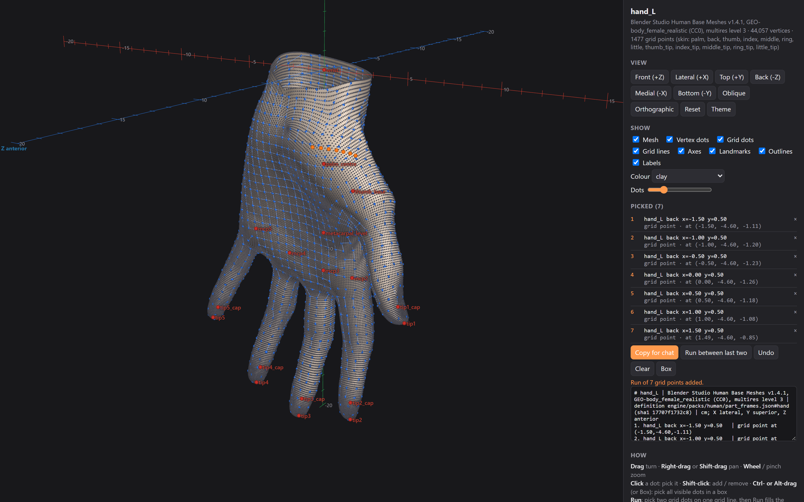

<h1 align="center">Self-improving engines</h1>

<p align="center">
  <b>Claude Code skills for building agent engines that get measurably better every run,<br>
  and a Blender engine built with them that refines 3-D assets by measurement.</b>
</p>

<p align="center">
  <a href="#install"></a>
  
  
  
</p>

<p align="center">
  
  <br><sub>The <a href="docs/translator.md">Translator</a>: quickly identify problems or areas you wish to refine. Select the region, area, or single point, and copy the precise coordinates of what you're looking at into your AI tools. Describe the change, and it sees what you see. The coordinates are the translation between your explanation and the language that your AI understands.</sub>
</p>

## What's inside

| Plugin | What it does |
|---|---|
| 🔁 [**Recursive improvement**](plugins/recursive-improvement/) | Builds and matures an engine (a repeatable agent pipeline) across many runs: blind runs, scoring against a hidden answer key, every defect turned into a permanent check, lessons kept with their evidence. |
| 🧭 [**Engine grounding**](plugins/engine-grounding/) | Its companion: where every value comes from and how sure it is, references as evidence rather than authority, baselines before changing working code, and every human note accounted for. |
| 📐 [**Asset enhancement engine**](plugins/asset-enhancement-engine/) | Improves an existing 3-D asset in Blender (a generator's model, a scan, an earlier approved model). Every form is measured, mapped and refined by numbers, with cited anatomy as evidence. Includes the Translator. |
| ✉️ [**Lesson reporter**](plugins/lesson-reporter/) | Off by default. Packages engine lessons into a redacted local outbox for you to read and approve. A prototype that makes no network calls. |

## The Translator

Made for vibe-coders and anyone new to Blender who uses AI to do their 3-D modelling. Telling an AI exactly where
to work on a model is the hard part: "the lower outer edge", "a bit above the elbow". The Translator turns what
you mean into a language your AI can act on with precision. It breaks a model into its parts, gives each one its
own ruler and lays a grid of addresses over the skin. Click the spots you mean, paste them into chat with your
request, and a line like `hand_L back x=0.00 y=0.50` points at the same spot every time, even after the model is
remeshed. It works on any object too: tested on a whole body, a dragon, a brick and a street lantern.

<p align="center">
  
  <br><sub>The body is unclothed for the same reason an anatomy reference is: the Translator maps the skin itself.</sub>
</p>

**[How to open and use it →](docs/translator.md#open-it)** · [More on the Translator](docs/translator.md)

## Proven so far

<p align="center"></p>

- **A cat** *(unfinished)*. A generator's 3-D model was measured surface by surface and rebuilt as anatomical parts,
  then given a groomed coat: a 23-million-triangle skin and about 632,000 strands of fur on the body alone. Still to
  come: the eyes, the nose, refining and colouring the fur, and a few other touch-ups.
- **A human torso.** An anatomical adult torso refined over twelve measured versions, then rig and pose tests (shoulder rhythm and the scapula seen from the back), now moving to a full base body.

**Next on the ladder:** a head with real eyes and skin, then a full body, then clothes that move with the body, have
real fabric texture and react to what's around them.

**Also in the pipeline, just for fun:** 3-D structures, a qilin and a few other objects.

## Install

In Claude Code:

```
/plugin marketplace add dirtcodevet/self-improving-engines
/plugin install recursive-improvement@self-improving-engines
/plugin install engine-grounding@self-improving-engines
/plugin install asset-enhancement-engine@self-improving-engines
```

The engine needs Blender 5.2 and Python with numpy. Details are on [its page](plugins/asset-enhancement-engine/).

## Design philosophy and methodology

Math first: measure, map, then refine by numbers. An engine earns trust the way an instrument does, by being
checked against known cases, and it gets cheaper with every run because what it learns stays in it.

- **Measure before asserting.** No fact about a model without its measurement, and a tool's label is not a
  measurement. A new measure is proven once on a known shape before it is allowed to drive a change.
- **Build from causes, not catalogues.** Structure comes before appearance, in the subject's own layers: frame,
  muscle, skin, then what grows on the skin. Every shape, shadow and line comes from structure and shows in a plain
  clay render; paint goes only where real pigment is.
- **Evidence, ranked.** What the input measures wins, then constraints that must hold together, then a good
  reference measured the same way, then indirect cues, then cited sources, then one plain question to a person. References,
  AI-made ones included, are evidence, not authority, and every value records where it came from.
- **Lessons become checks.** Every defect found becomes a check, proven on a planted copy of that defect, and it
  runs on every build from then on. Checks only tighten unless a person approves otherwise, and approved work is
  re-checked after every later build.
- **Methods, not handcuffs.** The skills hold ways of working, applied with judgement. The tool library is a
  starting kit, never a fence: a new tool is welcome once it is proven. Every lesson on trial has its own switch in
  `flags.json`, with the original text kept for rollback.

<details>
<summary><b>How the work is run</b></summary>

- **The engine makes the model.** A fix done by hand is a lesson. It lands in the engine's code, so the next model
  needs less help.
- **Fresh builders, real tests.** Each build goes to a fresh agent with a job description: the issue, the person's
  decisions, the conditions and what to report. It finds the method itself, so every build also tests the engine.
- **Scored outside the builder.** Answer keys live where no builder can read them, and a builder's self-review is a
  minimum bar, never evidence.
- **Cost is measured.** Every run's tokens and time are read from its transcript and kept in a ledger.
</details>

## Support and contact

This is independent work. If it's useful to you, or you'd like to sponsor or collaborate, reach
[@dirtcodevet](https://github.com/dirtcodevet) on GitHub. [Contributing](CONTRIBUTING.md) ·
[Security](SECURITY.md) · [Changelog](CHANGELOG.md)

**License:** [Apache-2.0](LICENSE). A few third-party pieces keep their own terms; [NOTICE](NOTICE) lists them.
