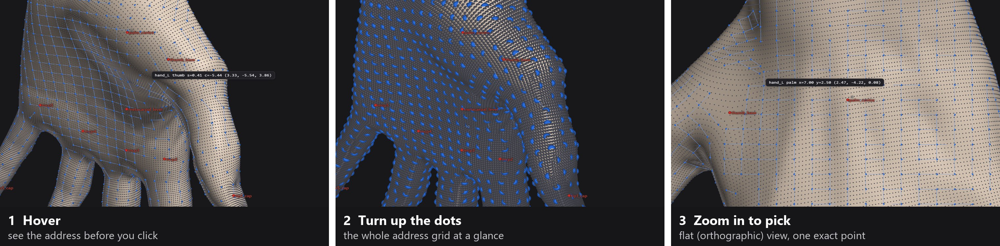
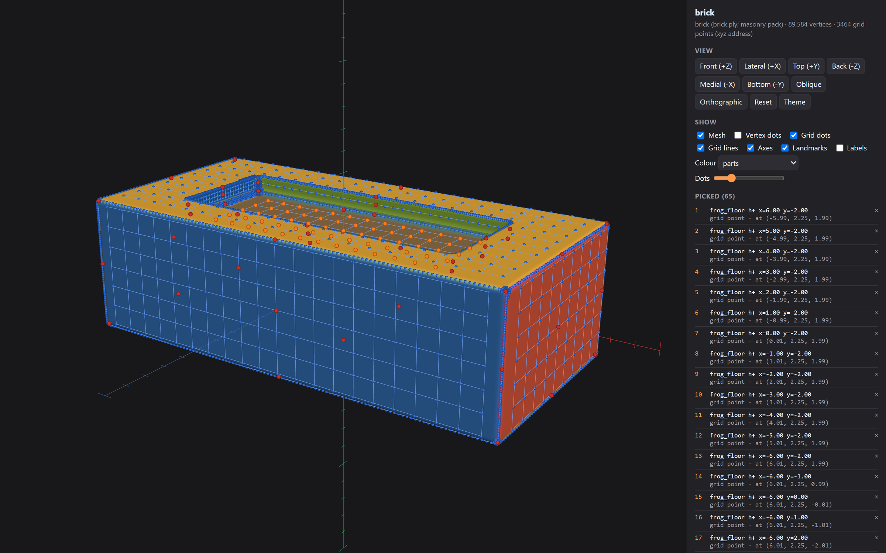
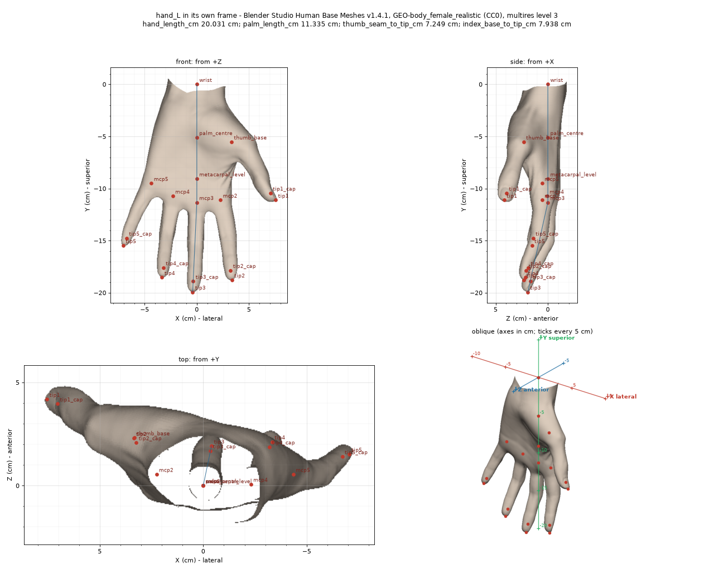
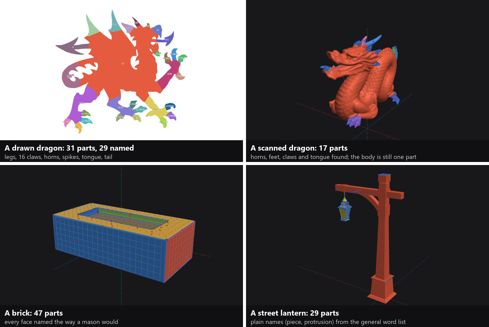

# The Translator

**[← Back to the overview](../README.md)** · Part of the [asset enhancement engine](../plugins/asset-enhancement-engine/)

**Made for vibe-coders and anyone new to Blender who uses AI to do their 3-D modelling.**

You know what you want changed. Saying exactly where, in words an AI can act on, is the hard part: "the lower outer
edge", "a bit above the elbow". The Translator turns what you mean into a language your AI tool understands and can
execute with precision. It breaks a model into its parts, gives each one its own ruler in centimetres, and lays a
grid of addresses over the skin. You click the spots you mean in your browser, paste them into chat along with what
you want done, and the AI works on exactly those spots.

<p align="center">
  
  <br><sub>Pick two points on the back of the hand, press "Run between last two", and the five points between them are filled in, listed and ready to copy.</sub>
</p>

## Open it

**The quickest:** type `/translator` in Claude Code. On its own it opens the Translator's home page, which lists
every model you've mapped. `/translator brick` or `/translator left hand` opens that one by name. Give it a file, as
in `/translator C:\models\brick.glb`, and it maps that model first.

**Or just ask your AI**, for example *"Open the Translator on C:\models\brick.glb"*. It can run the command below
for you and open the page.

**Or run it yourself** from the engine's skill folder (`skills/asset-enhancement-engine/` in this plugin):

```
python tools/language.py auto C:/models/brick.glb --case C:/models/brick --pack generic --open
```

- **The model:** an `.obj`, `.ply` or `.stl` file, or a `.png` or `.jpg` picture. `.glb`, `.gltf`, `.fbx`, `.blend`
  and `.dae` files are read through Blender, so Blender must be installed.
- **`--case`:** the folder where its pages are saved. Give a full path.
- **`--pack`:** the word list it names parts from: `generic` (anything), `human` (a person), `creature` or
  `masonry`. Leave it out for `generic`.
- **`--open`:** opens the list of parts in your browser when it's done (on Windows; elsewhere, open the file
  yourself).

**Coming back later.** Run `python tools/language.py open` for the home page, or `python tools/language.py open
"left hand"` to go straight to a part. Or double-click the files: everything stays in the case folder, and no server
or install is needed.

| File | What it opens |
|---|---|
| `index.html` in your Translator folder | the home page: every model you've mapped, each with its whole view and its parts |
| `<case>/language/index.html` | the list of parts, with **Open the whole object** at the top |
| `object.html` | the whole model, coloured by part, with the same list in its side panel |
| `<part name>.html` | one part on its own, with its own ruler |

## How you use it

<p align="center">
  
</p>

Hover over any dot to see its address before you click; here the cursor sits on the base of the thumb, which has its
own grid. Turn up the dot size to see the whole grid at once. For fine work, switch to the flat (orthographic) view
and zoom in until single points separate.

| Moving around | |
|---|---|
| Turn the model | drag |
| Slide it sideways | right-drag, or Shift-drag |
| Zoom | mouse wheel, or pinch |
| Look straight at one side | the view buttons: **Front**, **Back**, **Top**, **Bottom**, **Oblique**, and **Lateral** / **Medial** on a part (**Its right** / **Its left** on the whole object) |
| Jump to another part | type its name in **Go to a part**, or use the links at the top: home, whole body, parts list |
| Flat view, for exact picking | **Orthographic** |
| Start over | **Reset** |
| Show or hide things | the **Show** boxes: mesh, vertex dots, grid dots, grid lines, axes, landmarks, labels |
| Bigger or smaller dots | the **Dots** slider |
| Light or dark page | **Theme** |
| See bumps, ridges and dents | **Variance**, or press V ([more below](#seeing-small-changes-in-the-surface)) |

| Picking spots and sending them | |
|---|---|
| Pick one spot | click a dot |
| Add or remove a spot | Shift-click |
| Pick every visible dot in an area | Ctrl-drag or Alt-drag, or press **Box** and drag |
| Fill in a line of spots | pick two dots on one grid line, then **Run between last two** |
| Take back a pick | **Undo**; **Clear** empties the list |
| Send them to your AI | **Copy for chat**, paste into chat, and say what you want done |

## Asking for a change

Here's a real request on the brick. Pick the floor of the hollow on top (bricklayers call it the frog), copy, and
say in plain words what you want:

<p align="center">
  
</p>

> **You:** Recess this region further into the brick by 3 points on the Y axis.

```
# brick | brick (brick.ply; masonry pack) | definition cases/brick1/language/definitions.json#(the whole object) (sha1 -) | cm; X right, Y up, Z front
1. frog_floor h+ x=6.00 y=-2.00   | grid point at (-5.99, 2.25, 1.99)
2. frog_floor h+ x=5.00 y=-2.00   | grid point at (-4.99, 2.25, 1.99)
3. frog_floor h+ x=4.00 y=-2.00   | grid point at (-3.99, 2.25, 1.99)
...
65. frog_floor h+ x=-5.00 y=1.00   | grid point at ( 5.01, 2.25,-1.01)
```

<details>
<summary><b>All 65 picked points</b></summary>

```
# brick | brick (brick.ply; masonry pack) | definition cases/brick1/language/definitions.json#(the whole object) (sha1 -) | cm; X right, Y up, Z front
1. frog_floor h+ x=6.00 y=-2.00   | grid point at (-5.99, 2.25, 1.99)
2. frog_floor h+ x=5.00 y=-2.00   | grid point at (-4.99, 2.25, 1.99)
3. frog_floor h+ x=4.00 y=-2.00   | grid point at (-3.99, 2.25, 1.99)
4. frog_floor h+ x=3.00 y=-2.00   | grid point at (-2.99, 2.25, 1.99)
5. frog_floor h+ x=2.00 y=-2.00   | grid point at (-1.99, 2.25, 1.99)
6. frog_floor h+ x=1.00 y=-2.00   | grid point at (-0.99, 2.25, 1.99)
7. frog_floor h+ x=0.00 y=-2.00   | grid point at ( 0.01, 2.25, 1.99)
8. frog_floor h+ x=-1.00 y=-2.00   | grid point at ( 1.01, 2.25, 1.99)
9. frog_floor h+ x=-2.00 y=-2.00   | grid point at ( 2.01, 2.25, 1.99)
10. frog_floor h+ x=-3.00 y=-2.00   | grid point at ( 3.01, 2.25, 1.99)
11. frog_floor h+ x=-4.00 y=-2.00   | grid point at ( 4.01, 2.25, 1.99)
12. frog_floor h+ x=-5.00 y=-2.00   | grid point at ( 5.01, 2.25, 1.99)
13. frog_floor h+ x=-6.00 y=-2.00   | grid point at ( 6.01, 2.25, 1.99)
14. frog_floor h+ x=-6.00 y=-1.00   | grid point at ( 6.01, 2.25, 0.99)
15. frog_floor h+ x=-6.00 y=0.00   | grid point at ( 6.01, 2.25,-0.01)
16. frog_floor h+ x=-6.00 y=1.00   | grid point at ( 6.01, 2.25,-1.01)
17. frog_floor h+ x=-6.00 y=2.00   | grid point at ( 6.01, 2.25,-2.01)
18. frog_floor h+ x=-5.00 y=2.00   | grid point at ( 5.01, 2.25,-2.01)
19. frog_floor h+ x=-4.00 y=2.00   | grid point at ( 4.01, 2.25,-2.01)
20. frog_floor h+ x=-3.00 y=2.00   | grid point at ( 3.01, 2.25,-2.01)
21. frog_floor h+ x=-2.00 y=2.00   | grid point at ( 2.01, 2.25,-2.01)
22. frog_floor h+ x=-1.00 y=2.00   | grid point at ( 1.01, 2.25,-2.01)
23. frog_floor h+ x=0.00 y=2.00   | grid point at ( 0.01, 2.25,-2.01)
24. frog_floor h+ x=1.00 y=2.00   | grid point at (-0.99, 2.25,-2.01)
25. frog_floor h+ x=2.00 y=2.00   | grid point at (-1.99, 2.25,-2.01)
26. frog_floor h+ x=3.00 y=2.00   | grid point at (-2.99, 2.25,-2.01)
27. frog_floor h+ x=4.00 y=2.00   | grid point at (-3.99, 2.25,-2.01)
28. frog_floor h+ x=5.00 y=2.00   | grid point at (-4.99, 2.25,-2.01)
29. frog_floor h+ x=6.00 y=2.00   | grid point at (-5.99, 2.25,-2.01)
30. frog_floor h+ x=6.00 y=1.00   | grid point at (-5.99, 2.25,-1.01)
31. frog_floor h+ x=6.00 y=0.00   | grid point at (-5.99, 2.25,-0.01)
32. frog_floor h+ x=6.00 y=-1.00   | grid point at (-5.99, 2.25, 0.99)
33. frog_floor h+ x=5.00 y=-1.00   | grid point at (-4.99, 2.25, 0.99)
34. frog_floor h+ x=4.00 y=-1.00   | grid point at (-3.99, 2.25, 0.99)
35. frog_floor h+ x=3.00 y=-1.00   | grid point at (-2.99, 2.25, 0.99)
36. frog_floor h+ x=2.00 y=-1.00   | grid point at (-1.99, 2.25, 0.99)
37. frog_floor h+ x=1.00 y=-1.00   | grid point at (-0.99, 2.25, 0.99)
38. frog_floor h+ x=0.00 y=-1.00   | grid point at ( 0.01, 2.25, 0.99)
39. frog_floor h+ x=-1.00 y=-1.00   | grid point at ( 1.01, 2.25, 0.99)
40. frog_floor h+ x=-2.00 y=-1.00   | grid point at ( 2.01, 2.25, 0.99)
41. frog_floor h+ x=-3.00 y=-1.00   | grid point at ( 3.01, 2.25, 0.99)
42. frog_floor h+ x=-4.00 y=-1.00   | grid point at ( 4.01, 2.25, 0.99)
43. frog_floor h+ x=-5.00 y=-1.00   | grid point at ( 5.01, 2.25, 0.99)
44. frog_floor h+ x=-5.00 y=0.00   | grid point at ( 5.01, 2.25,-0.01)
45. frog_floor h+ x=-4.00 y=0.00   | grid point at ( 4.01, 2.25,-0.01)
46. frog_floor h+ x=-3.00 y=0.00   | grid point at ( 3.01, 2.25,-0.01)
47. frog_floor h+ x=-2.00 y=0.00   | grid point at ( 2.01, 2.25,-0.01)
48. frog_floor h+ x=-1.00 y=0.00   | grid point at ( 1.01, 2.25,-0.01)
49. frog_floor h+ x=0.00 y=0.00   | grid point at ( 0.01, 2.25,-0.01)
50. frog_floor h+ x=1.00 y=0.00   | grid point at (-0.99, 2.25,-0.01)
51. frog_floor h+ x=2.00 y=0.00   | grid point at (-1.99, 2.25,-0.01)
52. frog_floor h+ x=3.00 y=0.00   | grid point at (-2.99, 2.25,-0.01)
53. frog_floor h+ x=4.00 y=0.00   | grid point at (-3.99, 2.25,-0.01)
54. frog_floor h+ x=5.00 y=0.00   | grid point at (-4.99, 2.25,-0.01)
55. frog_floor h+ x=5.00 y=1.00   | grid point at (-4.99, 2.25,-1.01)
56. frog_floor h+ x=4.00 y=1.00   | grid point at (-3.99, 2.25,-1.01)
57. frog_floor h+ x=3.00 y=1.00   | grid point at (-2.99, 2.25,-1.01)
58. frog_floor h+ x=2.00 y=1.00   | grid point at (-1.99, 2.25,-1.01)
59. frog_floor h+ x=1.00 y=1.00   | grid point at (-0.99, 2.25,-1.01)
60. frog_floor h+ x=0.00 y=1.00   | grid point at ( 0.01, 2.25,-1.01)
61. frog_floor h+ x=-1.00 y=1.00   | grid point at ( 1.01, 2.25,-1.01)
62. frog_floor h+ x=-2.00 y=1.00   | grid point at ( 2.01, 2.25,-1.01)
63. frog_floor h+ x=-3.00 y=1.00   | grid point at ( 3.01, 2.25,-1.01)
64. frog_floor h+ x=-4.00 y=1.00   | grid point at ( 4.01, 2.25,-1.01)
65. frog_floor h+ x=-5.00 y=1.00   | grid point at ( 5.01, 2.25,-1.01)
```
</details>

Your AI now knows exactly which 65 points you mean, which part they sit on (the frog's floor), how far apart they
are (1 cm) and which way "Y" points on this brick, so "3 points" has one meaning: 3 cm.

## What you paste into chat

```
# hand_L | Blender Studio Human Base Meshes v1.4.1, GEO-body_female_realistic (CC0), multires level 3 | definition engine/packs/human/part_frames.json#hand (sha1 17707f1732c8) | cm; X lateral, Y superior, Z anterior
1. hand_L back x=-1.50 y=0.50   | grid point at (-1.50,-4.60,-1.11)
2. hand_L back x=-1.00 y=0.50   | grid point at (-1.00,-4.60,-1.20)
3. hand_L back x=-0.50 y=0.50   | grid point at (-0.50,-4.60,-1.23)
4. hand_L back x=0.00 y=0.50    | grid point at (0.00,-4.60,-1.26)
```

The first line says which model and which version of the part you clicked on, so nobody ends up working on the
wrong one. The agent looks each line up with `resolve`:

```
$ python tools/part_frame.py resolve hand_L.npz "hand_L back x=0.00 y=0.50"
{"address": "hand_L back x=0.00 y=0.50", "frame_cm": [0.00, -4.60, -1.26], "facing": 0.998, "nearest_vertex_this_build": 23681, ...}
```

## Every part, broken out for review

<p align="center">
  
  <br><sub>The left hand on its own, from four sides, with its landmarks (wrist, knuckles, fingertips) and its measurements: hand 20.0 cm, palm 11.3 cm.</sub>
</p>

- **Its own ruler.** Each part is measured from its own anatomy: outward, up and forward, in centimetres. Left and
  right are mirrored, so "outward" means the same on both sides.
- **A grid that hugs the skin.** The addresses stay evenly spaced over slopes and around curves: the back and palm
  of the hand, each finger, the arm all the way round. They're a centimetre apart on most of the body and much
  closer where the detail is small: 2.5 mm over the areola and 1 mm over the nipple on the torso.
- **Its numbers come with it.** Each part carries its own measurements, so you can check a change against them.

<p align="center">
  
  
  <br><sub>One breast from the torso test, measured on its own. Left: the browser view, coloured by height above the chest wall, with the grid closing in over the areola and nipple. Right: the same height as a wireframe: 17.0 × 14.5 cm across, 4.9 cm deep, 470 mL.</sub>
</p>

## Commands

| Command | What it does |
|---|---|
| `python tools/part_frame.py build <job.json>` | breaks a model into its parts and writes each part's data, chart and browser view. A short job file says which mesh to use; the part definitions live in `packs/<domain>/part_frames.json` |
| `python tools/part_frame.py resolve <part>.npz "<address>"` | shows where a pasted address lands on the current mesh |
| `python tools/part_frame.py prove` | runs the tool's own checks |
| `tools/bl_export_mesh.py` | exports a mesh from Blender for `build` |
| `python tools/language.py auto <model or image> --case <folder> --pack <kind> --open` | breaks any 3-D model or 2-D image into named parts, builds all of its views and opens them ([Open it](#open-it)) |
| `python tools/language.py open [name]` | opens the home page, or a model or part by name, e.g. `open "brick"`, `open "left hand"` |
| `python tools/language.py rename`, `cut`, `merge` | your own corrections to the parts, kept across rebuilds |
| `python tools/language.py regress` | checks that every part you've picked from before still lands in the same place |

Each part's view is a single HTML file, with an index page that lists them all. It runs in any current browser.

<details>
<summary><b>Why addresses, not vertex numbers</b></summary>

A vertex number only means something on one version of one mesh. Remesh it, subdivide it or fix a fold, and every
number changes. An address belongs to the part and its skin, so it still lands in the same place after the mesh
changes. Older addresses keep working when the tool grows: the skin-hugging grid was added later, and the first
addresses still resolve alongside it.
</details>

## Any object, not just bodies

The Translator now breaks down any 3-D model or 2-D image on its own: it splits the object into parts, names them from
a word list for that kind of thing (a creature, masonry, or a general list), and gives each part its ruler and grid.
The words live in a data file per kind of object, so a new kind of object needs a new list, not new code.

<p align="center">
  
</p>

| Test | Parts | How it did |
|---|---|---|
| A drawn dragon (2-D) | 31, 29 named | every point addressed; 4 legs, 16 claws, horns, spikes, tongue and tail. The wing points came out as "spikes", and the head and wing stay in the body |
| A scanned dragon (3-D) | 17, 16 named | horns, claws, feet and tongue found; the head, neck, legs and coiled tail are still one big body part. You can split a part yourself by picking points along the cut |
| A brick | 47, all named | every face and edge named in mason's words (header, stretcher, bed and so on), every point addressed |
| A street lantern | 29 | the pole and its pieces, with plain names from the general list |
| A whole body (3-D) | 37, all named | with the word list for people: head, ears, eyes, nose, lips, neck, torso, breasts, arms, hands, every finger, legs, feet and toes ([below](#blender-human-model-auto-mapped-and-labelled)) |

**It stays up to date by itself.** Every part remembers what it was made from. When the model changes, only the parts
that went out of date are rebuilt, without anyone asking, and they keep their names and any renames you made. Remeshing
the brick moved its addresses by at most 0.27 mm; chipping a corner off it left 43 of the other 46 parts within
0.05 mm, and reported the corner as gone. On the scanned dragon, remeshing moved the median part by 0.08 mm but the feet
by up to 9.5 mm, which isn't explained yet.

<details>
<summary><b>Where the test objects come from</b></summary>

- The scanned dragon is the Stanford Dragon, from the Stanford Computer Graphics Laboratory's 3D Scanning Repository
  (free for research use, with credit; not for commercial use).
- The drawn dragon is "Dragon silhouette 2" by Angelus, Wikimedia Commons, CC BY-SA 3.0. The coloured version above is
  a derivative and is shared under the same licence.
- The street lantern is Khronos Group's glTF sample "Lantern" (CC0).
- The brick was generated by the engine, at a standard brick's size.
</details>

## Seeing small changes in the surface

Every page has a **Variance** button (or press V). It colours the skin by how far each spot sits above or below the
smooth shape around it: red where it rises, blue where it sinks, plain where nothing stands out. **Size** sets how wide
a feature to look for, from a 2 mm ridge to a 4 cm swell; anything broader counts as the body's own shape. **Show
from** sets how high or deep a feature must be before it's coloured, and **Auto** puts it just above the mesh's own
noise. Tick **Finer** to go down to pore level. Curved skin on its own stays plain, so what lights up is a real change
in the surface.

It was checked on made-up surfaces first: bumps, dents, ridges and grooves of known sizes show at the size that should
catch them and stay plain at one that shouldn't, and a clean surface stays plain. At the finest sizes it picks up
features about a tenth of a millimetre high. We also checked that it reads the same way round on every page: on
made-up surfaces shown mirrored, as the right side's pages are, and on a closed shape stored inside out, a bump still
shows red and a dent blue.

## Blender human model, auto-mapped and labelled

We gave the Translator a whole human body, built on Blender Studio's free base model (CC0) as the new base for our
torso test. With its word list for people it maps the whole body on its own: 37 named parts over 686,418 vertices,
each with its own ruler and address grid. The head comes apart into each ear, each eye, the nose, the lips and the
mouth; below it come the neck, the torso, both breasts, the arms, hands and every finger, the legs, feet and toes.
The same list was tried on three other bodies, one of them held back until the end, and found the same parts on
each. Type a part's name in **Go to a part**, or `/translator left ear`, and it opens on its own.

## What's next

- **Soft creases in the variance view.** A dent stands out clearly; a soft crease where a breast meets the chest
  still reads no louder than the skin right next to it.
- **Smarter splitting on scanned creatures,** so a head, legs and a coiled tail come out as their own parts.
- **More word lists** for more kinds of objects, each learned the same way.
