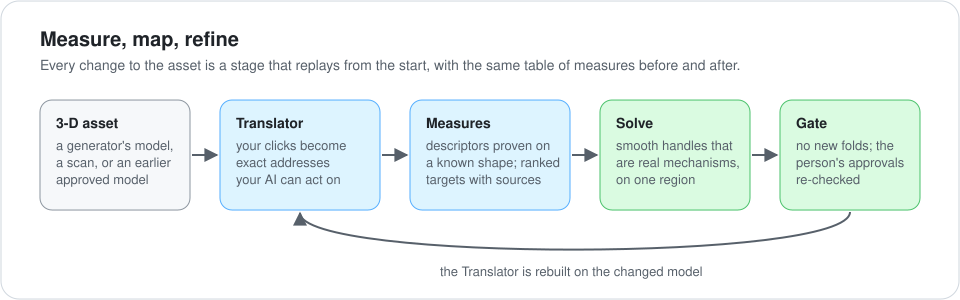
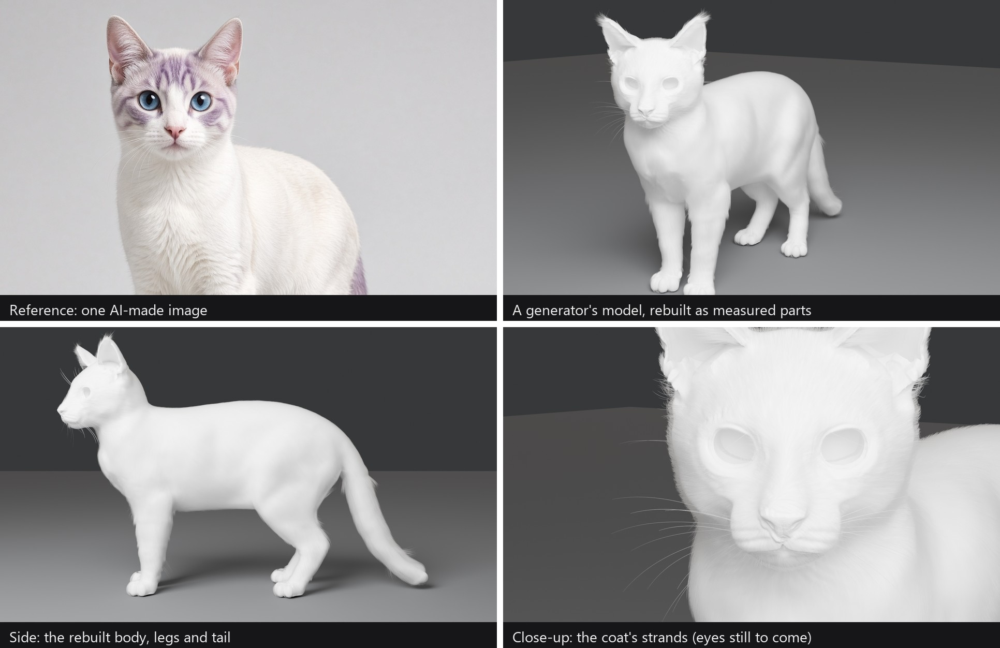

# Asset enhancement engine

**[← Back to the overview](../../README.md)** · Plugin id `asset-enhancement-engine` · Status: experimental

Improves an existing 3-D asset in Blender (a generator's model, a scan, an earlier approved model) by
systematic, recursive, long-horizon optimization. Every form is measured, mapped and refined by numbers, with
cited anatomy and measured findings as evidence. Reference images are optional, never an instruction.

<p align="center"></p>

## What it does

- **Measures before it changes anything.** Descriptors such as a profile's convex and concave arcs, a limb
  section's flat share, folded faces and volume above a wall are each proven once on a known shape before they
  drive a change.
- **Maps the model.** The [Translator](../../docs/translator.md) breaks the model into parts with exact
  addresses on the skin, so your notes and the agent's edits point at the same spots.
- **Refines by solving, not by sculpting.** Ranked targets (measured input first, then a reference measured the
  same way, then cited sources) drive smooth handles that are real mechanisms, solved on one region at a time.
  There are no hand-sculpting steps: every change is a recipe stage that replays from the base.
- **Builds in the subject's own layers.** Frame, then muscle, then skin and features, then what grows on the skin,
  then pigment, then rig and motion. Each layer is accepted before the next, and a later layer never covers up
  an earlier one's defect.
- **Gates every build.** No new folded faces. Approved parts are re-checked after every later build. Every stage
  checks its own output.

## Tested on

<p align="center"></p>

| Test | What it exercised |
|---|---|
| **A cat** | A generator's model measured surface by surface and rebuilt as parts: eyes with lids lying on the globe, ears seated on the head, a mouth that closes at rest, toes, then a zoned, layered coat |
| **A human torso** | An adult torso refined over twelve measured versions: breast form and nipple-areola from cited clinical measures, skin micro-relief, a chest wall, corrective shapes, then rig and pose tests of the shoulder rhythm and the scapula seen from the back |

<details open>
<summary><b>The cat, by the numbers</b> <i>(unfinished)</i></summary>

| | |
|---|---|
| Skin | 23.0 million triangles, one closed shell, built in about 65 minutes. The renders above use a 4-million-triangle preview of it. |
| Fur on the body | 631,798 strands, 4,632,748 points |
| Fur on the ears | 211,452 strands, 1,691,616 points |
| Whiskers | 49 |
| Each render | Cycles, 256 samples, about 45 seconds on an RTX 5050 graphics card (8 GB) |

The cat is unfinished. Still to come: the eyes (the sockets are empty in the close-up), the nose, refining the fur
(the coat shown was grown on the previous version of the skin and will be regrown on this one), colouring the fur,
and a few other touch-ups.
</details>

Next on the ladder: a head (eyes, skin, hair), a full body, then clothes that move with the body, have real fabric
texture and react to what's around them. Also in the pipeline, just for fun: 3-D structures, a qilin and a few other
objects.

## What you need

- **Blender 5.2.** Builders run background Blender (`blender -b --factory-startup --python <script>`). A live
  viewport for review uses a Blender MCP add-on listening on `localhost:9876`; `tools/blender_second.py` starts a
  second instance on another port.
- **Python 3.12** with numpy, scipy, opencv-python, scikit-image, Pillow and matplotlib.
- **A 3-D asset to start from.** From flat images alone the engine has nothing that reads the form inside an
  outline, so it starts from a model.
- Optional third-party tools (Pose Shape Keys, Robust Weight Transfer, OpenSim's thoracoscapular shoulder model)
  load from the project's `vendor/` folder and are not shipped here: [VENDOR.md](VENDOR.md).

## What's in the skill folder

| Folder | What |
|---|---|
| `SKILL.md`, `flags.json` | the engine's memory, with 25 switchable items (trial items and judgment lessons); `SKILL.pre_lessons_*.md` is the text before them |
| `tools/` (96 scripts) | measuring, fitting, building, rendering and review tools; the Translator (`part_frame.py`, `part_frame_view.html`) |
| `loop/` | the target loop: `Target`, `measure`, `solve`, regions, rigged posing in numpy, the recipe that replays stages |
| `checks/` (30), `review/` (20) | build gates with their planted-defect proofs, and the review tools (seam fairness, alignment, reviewer packets) |
| `references/` | the builder primer, Blender gotchas, the layered build, the target loop, cited anatomy |
| `packs/` | domain knowledge as data (felid, human, rock): structure inventories, part definitions, cited references and measured findings |
| `log/` | `METHOD.md` (the teaching log) and `TOOLMAKING.md` (the tool index: why each tool exists and what it caught) |

Binary pack data is listed in [BINARIES.md](BINARIES.md) and is not committed yet. Sample models and case work stay
in the project; `tools/publish_rules.json` at the repo root says what is published.

## Install

```
/plugin install asset-enhancement-engine --marketplace dirtcodevet/self-improving-engines
```

On Claude Code older than 2.1.275, add the marketplace first (`/plugin marketplace add dirtcodevet/self-improving-engines`), then `/plugin install asset-enhancement-engine@self-improving-engines`.

It works with [recursive-improvement](../recursive-improvement/) and [engine-grounding](../engine-grounding/) (declared
as dependencies); install those too.

<details>
<summary><b>Packaging files beside the skill</b></summary>

| File | What |
|---|---|
| `reporter.json` | what the lesson reporter may package for this engine (allowlisted folders, limits, merge targets) |
| `proofs.json` | a draft registry of the checks' planted-defect proofs, for CI |
| `BINARIES.md` | the binary pack files kept out of git, with sha256 |
| `VENDOR.md` | the third-party tools the engine can load, with sources and licences |
</details>
