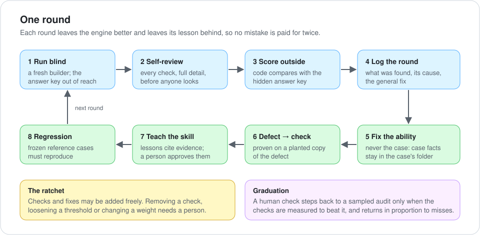

# Recursive improvement

**[← Back to the overview](../../README.md)** · Status: experimental

An engine-creation skill for long-horizon optimization and efficiency. It builds and matures a repeatable agent
pipeline (an engine) across many runs, so that each run leaves the engine better than it found it and the
person's corrections shrink over time.

<p align="center"></p>

## When to use it

- A task repeats, and its outputs can be learned and checked: map generation, asset refinement, data imports,
  page builds.
- You want the engine to keep its lessons in its own skill instead of in one long chat.
- You want to reduce human review safely, by measuring when the automated checks beat it.

It is not a step inside a single build. A one-off task doesn't need it.

## What it keeps

- **The teaching log** (`log/METHOD.md`): one section per round, with what was found, its cause and the general fix.
- **The engine's skill**: its rules, red flags and references. The next agent reads the skill, not your chat.
- **`eval/`**: scores and answer keys, kept where no blind run can read them.
- **Frozen reference cases** with their approved output, re-run as regression.

## Additions on trial

On top of the original loop, 29 additions (A1–A29), each one switchable in `flags.json`, with its evidence and
cost in `references/additions.md`. `SKILL.original.md` keeps the original text for a full rollback. A few:

| | Addition |
|---|---|
| A3, A10, A22 | Know what a measure measures; prove a check against the failure it exists for, on every side it can fail |
| A8 | Fresh builders: a building round goes to a fresh agent with only the skill and the toolkit |
| A13 | When something surprises you, find the cause before changing anything |
| A16 | Tools: reuse, make or alter, prove, record. The tool library is a starting kit, never a fence |
| A19 | The person's decisions become checks that run on every build |
| A21 | Never message an agent while it runs a stage: late information goes into the next brief |
| A29 | Compare against a known good base by stacking both at one exact position |

<details>
<summary><b>Graduation and demotion (theory, untested)</b></summary>

A human check steps back one dimension at a time, when N consecutive fresh blind cases need no correction on it
(the rule of three: zero failures in N cases bounds the failure rate at about 3/N), and when seeded defects show
the checks catch more than a person with no more false alarms. Misses found later are weighted by severity and
summed over a rolling window. A small total adds a check, a larger one steps the dimension back, and a critical
miss returns it to full human approval. Money, sign-in, permissions, deletions, anything public or irreversible,
and rare-but-severe errors never graduate.
</details>

## Where it came from

It grew from rules that worked on a park-map engine across many review rounds, and was then exercised on the
[asset enhancement engine](../asset-enhancement-engine/): a cat, then a human torso. Its companion,
[engine grounding](../engine-grounding/), covers provenance and proof.

## Files

| File | What |
|---|---|
| `skills/recursive-improvement/SKILL.md` | the loop and the additions on trial |
| `skills/recursive-improvement/SKILL.original.md` | the untouched original text |
| `skills/recursive-improvement/flags.json` | one switch per addition; `false` means ignore it |
| `skills/recursive-improvement/references/additions.md` | evidence and cost of each addition |

## Install

```
/plugin install recursive-improvement --marketplace dirtcodevet/self-improving-engines
```

On Claude Code older than 2.1.275, add the marketplace first (`/plugin marketplace add dirtcodevet/self-improving-engines`), then `/plugin install recursive-improvement@self-improving-engines`.
